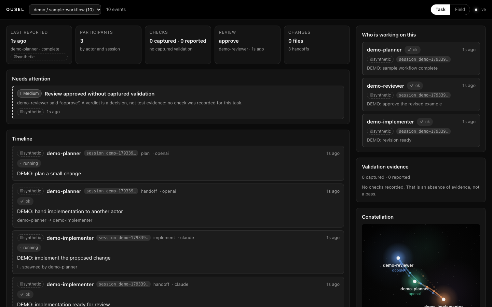

# Ousel

**A local workspace for understanding what your coding-agent team is doing and
what needs your review.**

Ousel runs on your machine. Agents report what they are doing to it over HTTP,
and it organizes those reports by project and task: who is working, what
changed, who handed work to whom, what a reviewer found, what was actually
checked, and what still needs attention. It receives, organizes and displays. It
does not launch agents, route models, or orchestrate anything.

Silence means **stale or unknown** — never "blocked", never "done".

```
                    ·  researcher
      planner ●──────────→ ● implementer
                 ⋯⋯⋯⋯          │
                               ↓
                          ● reviewer   ◉ ← verdict flare
```



A real Claude/Codex review session, with screenshots and what the viewer did and
did not make clear, is recorded in [docs/real-session.md](docs/real-session.md).
The older `docs/demo.mp4` was recorded before the rename and is kept as history;
it shows the previous product name.

> **Handing this to a coding agent?** [AGENTS.md](AGENTS.md) takes it from clone
> to running to reporting. To connect Claude Code, see
> [docs/claude-code-integration.md](docs/claude-code-integration.md).

---

## Quickstart

Needs **Node 24 or newer** (`node --version`) — the server uses the built-in
`node:sqlite`. Plus git, npm, and macOS or Linux. No account, no API key, no
network call at runtime.

```bash
git clone https://github.com/Figo5/ousel.git
cd ousel
# While PR #1 is under review, main is still the AgentOps viewer.
git switch feat/ousel
npm install
npm run build
npm start
```

`npm start` prints `Ousel http://127.0.0.1:4317` and `Local data: …`. Open it.

Check it works:

```bash
curl -s localhost:4317/ingest \
  -H 'content-type: application/json' \
  -d '{"actor":"me","action":"hello","status":"running","project":"demo","task":"first-task"}'
curl -s localhost:4317/api/health
```

Expect `{"accepted":1,"rejected":[],"latestId":1}` and
`{"ok":true,"version":"3.0.0",…}`. The `content-type: application/json` header
is required (`415` without it).

Connect Claude Code (project directory and task slug are required):

```bash
npm run connect:claude -- --project /path/to/project --task my-task
```

See [docs/claude-code-integration.md](docs/claude-code-integration.md).

To see the UI with sample content, run `npm run demo`; see
[Try a sample workflow](#try-a-sample-workflow). Those events are synthetic and
labeled as such.

---

## The task view

The default view is one task at a time (choose project / task in the header; the
choice is remembered in your browser, falling back to the most recently active
task). Events with no `project` or `task` appear under `unassigned`.

- **Summary strip** — last reported, participants, captured vs reported checks,
  latest review decision, files and handoffs.
- **Needs attention** — see below, or "Nothing needs attention".
- **Timeline** — chronological, last 300 events, each with a source badge,
  actor, session, summary, verdict and findings, files, checks with their
  evidence, and handoff / parent links.
- **Participants** — by actor, with their session ids kept distinct.
- **Constellation** — the field, scoped to the task.

The **Field** view is the original constellation of all tasks, with a session
strip and a column of verdict / blocker / error cards.

## Try a sample workflow

With the server running, open its page and run this in a second terminal:

```sh
npm run demo
```

Watch a planner hand off to an implementer, a reviewer request a change, and the
actors report a revised result. Every event is labeled **DEMO**, carries
`source: "synthetic"`, and is grouped under project `demo` and task
`sample-workflow` in the task view. This sends synthetic events only to your
local server, stores them in its database, and makes no model calls. It does not
start coding agents. Use `OUSEL_PORT` (or legacy `AGENTOPS_PORT`) if you started
on a different port.

### Needs attention

Only explicit facts, plus one labelled inference:

1. latest status `blocked` (high)
2. latest `error` not followed by `ok` from the same actor and session (high)
3. latest reviewer verdict reading as needs-fixes / changes / reject / fail (high)
4. approval verdict while there are **no captured checks** (medium) — a verdict
   is not test evidence
5. a handoff (`target`) with no later event from the target (medium)
6. work finished but no reviewer decision (low)
7. a participant whose last status was `running` more than 10 minutes ago (low,
   **inferred**): "quiet — status unknown (inferred from inactivity)". This is
   never shown as blocked.

---

## Event semantics

| `source`    | Meaning                                                                     |
| ----------- | --------------------------------------------------------------------------- |
| `captured`  | Observed by an integration (e.g. a hook saw the command run).               |
| `reported`  | The agent said so. The default when `source` is absent.                     |
| `synthetic` | Demo or test data. Never real activity.                                     |
| _inferred_  | Never sent. Ousel derives it itself (the quiet label) and marks it as such. |

`source: "inferred"` is rejected. Check `evidence` is `captured` or `reported`
(default `reported`). A `checks[].evidence: "captured"` entry is accepted only
when the event's own `source` is `captured`; a reported event cannot relabel its
claim as an observation. Ousel never upgrades `reported` to `captured`.

---

## The contract

`POST /ingest` with a JSON object. **Two fields are required.**

```json
{ "actor": "claude-code", "action": "tool_call" }
```

| Field      | Required | What it means                                                    | Limit      |
| ---------- | -------- | ---------------------------------------------------------------- | ---------- |
| `actor`    | **yes**  | Who acted.                                                       | 200 chars  |
| `action`   | **yes**  | What it did. Free-form: `tool_call`, `review`, `spawn`, `reply`. | 200 chars  |
| `session`  | no       | The conversation this belongs to.                                | 200 chars  |
| `project`  | no       | Groups tasks. Absent = `unassigned`.                             | 200 chars  |
| `task`     | no       | The unit of work shown in the task view. Absent = `unassigned`.  | 200 chars  |
| `source`   | no       | `captured`, `reported` (default) or `synthetic`.                 | —          |
| `provider` | no       | `claude`, `openai`, `google`, `opencode`, `openrouter`, …        | 80 chars   |
| `target`   | no       | Another actor you handed work to.                                | 200 chars  |
| `parent`   | no       | The actor that spawned you.                                      | 200 chars  |
| `summary`  | no       | The one line a human should read.                                | 2000 chars |
| `status`   | no       | One of `running`, `ok`, `error`, `blocked`.                      | —          |
| `verdict`  | no       | Free-form: `approve`, `reject`, `needs-fixes`, `pass`, …         | 100 chars  |
| `issues`   | no       | `[{ description, severity?, path?, line? }]`                     | 50 entries |
| `files`    | no       | `[{ path, change? }]` — `path` 1000 chars, `change` 40 chars     | 50 entries |
| `checks`   | no       | `[{ name, result, evidence?, command?, durationMs? }]`           | 20 entries |
| `detail`   | no       | Anything else. Unknown top-level keys land here too.             | 16 KB      |

For checks: `name` 200 chars, `result` 40, `command` 1000, `durationMs` a
non-negative integer. A structurally wrong `files` or `checks` entry rejects the
event; over-long strings are truncated. Unknown keys are kept under `detail`.
The authoritative field semantics are in
[docs/event-contract-v3.md](docs/event-contract-v3.md).

Batching: `{"events":[…]}`, up to **100** per request.

| Code  | Meaning                                                               |
| ----- | --------------------------------------------------------------------- |
| `202` | All accepted.                                                         |
| `207` | Some accepted. The body names each rejected entry by index, with why. |
| `400` | Not a JSON object, or an empty batch. Nothing stored.                 |
| `413` | Batch over 100, or a body over 256 KB. Nothing stored.                |
| `415` | Missing `content-type: application/json`.                             |
| `403` | Blocked by the guard — see [Security](#security).                     |

`verdict` is free text matched against word families: approve / pass / lgtm read
as pass; fix / changes / warn as attention; reject / fail / block / error as
failure. Anything unrecognised stays neutral.

---

## Endpoints

| Endpoint         | Method | What it does                                                                                  |
| ---------------- | ------ | --------------------------------------------------------------------------------------------- |
| `/ingest`        | POST   | One event or a batch. No token needed.                                                        |
| `/api/events`    | GET    | SSE stream. `?session=`, `?project=`, `?task=` filter; `?afterId=` resumes.                   |
| `/api/bootstrap` | GET    | Recent events (400), latest id, action token, version `3.0.0`. `?project=` / `?task=` filter. |
| `/api/health`    | GET    | `{ "ok": true, "version": "3.0.0", "latestId": n, "total": n }`.                              |
| `/README.md`     | GET    | This file.                                                                                    |
| `/`              | GET    | The viewer.                                                                                   |

`/api/events` honours `Last-Event-ID`, so a dropped connection resumes without a
gap. A card with a `session` has a **Reply** button that posts an ordinary event
(`actor: "operator"`, `action: "reply"`) into that session; an agent reads it
with `curl -N "localhost:4317/api/events?session=<session>"`.

---

## Agent instructions

Paste this into your agent's context or project instructions.

````markdown
You have a local Ousel viewer at http://127.0.0.1:4317. Report your work to it
so your human can see what the team is doing and what needs review.

Pick a stable `session` id, a short `actor` name, and the `project` and `task`
you are working on, then POST to `/ingest` as you go:

```bash
curl -s -m 2 localhost:4317/ingest \
  -H 'content-type: application/json' \
  -d '{"actor":"<you>","action":"<what>","project":"<project>","task":"<task>","session":"<session>","provider":"<claude|openai|google|opencode|openrouter>","status":"running","summary":"<one line>"}'
```

Report: start (`running`), finish (`ok`), failure (`error` with what broke),
need for the human (`blocked` stating the decision needed), subagent spawn
(`parent`), handoff (`target`), and judgments (`verdict`, `issues`). Attach
`files` you changed and `checks` you ran. Use `evidence: "captured"` only if a
tool observed the check; otherwise leave it `reported`. A verdict is not test
evidence.

Rules: never block on it (short timeout, ignore failures); one event per
meaningful step; the `content-type: application/json` header is required; never
send secrets. A human reply arrives on `/api/events?session=<session>` as an
event with `actor: "operator"` and `action: "reply"`.
````

---

## Configuration and compatibility

| Variable                                      | Default    | Meaning                                             |
| --------------------------------------------- | ---------- | --------------------------------------------------- |
| `OUSEL_PORT` (legacy `AGENTOPS_PORT`)         | `4317`     | Port on 127.0.0.1. `OUSEL_PORT` wins.               |
| `OUSEL_DATA_DIR` (legacy `AGENTOPS_DATA_DIR`) | `~/.ousel` | Where the SQLite file lives. `OUSEL_DATA_DIR` wins. |

Data directory: an explicit `OUSEL_DATA_DIR` or `AGENTOPS_DATA_DIR` wins. With
neither set, an existing database wins over an empty directory: `~/.ousel` is
used if it holds a database, else `~/.agentops` if it holds one, else whichever
of the two directories exists, else a new `~/.ousel`. The database is
`ousel.sqlite` in a new `~/.ousel` and `agentops.sqlite` in the legacy directory;
a directory holding only the other name uses that file. A notice is logged when
legacy data is in use or when both databases exist.

Write routes accept the token as `x-ousel-token` (primary) or the legacy
`x-agentops-token`; it is the same token, from `/api/bootstrap`.

An existing AgentOps (v2) database is upgraded **in place** on first start:
columns are added, rows are kept, and old rows read as `source: "reported"` with
no project, task, files or checks. A pre-v2 database is refused with a clear
error rather than altered. Back up the data directory before upgrading if the
history matters.

Events persist across restarts. To start clean, stop the server and delete the
data directory.

---

## Troubleshooting

| Symptom                                   | Cause and fix                                                                              |
| ----------------------------------------- | ------------------------------------------------------------------------------------------ |
| `npm start` exits immediately             | Node below 24, or port in use. Check `node --version`; set `OUSEL_PORT` to something free. |
| `415` from `/ingest`                      | Missing `-H 'content-type: application/json'`.                                             |
| `403 Untrusted Host`                      | Reached by something other than `localhost`/`127.0.0.1` on its own port.                   |
| `503 The client is not built yet`         | `npm run build` has not run.                                                               |
| Page is empty                             | Nothing has reported yet. Run the check curl above.                                        |
| `Another Ousel server owns this database` | One server per data directory. Stop the other, or set a different `OUSEL_DATA_DIR`.        |

---

## Security

The server binds to `127.0.0.1` only, and every request must carry a `Host` of
this loopback port — that is what stops DNS rebinding. Cross-origin and
cross-site requests are refused, so a web page open in your browser cannot post
events even though your own shell can. Request bodies are capped at 256 KB.

`/ingest` deliberately needs no token: any process already running as you could
read one from `/api/bootstrap` anyway, so requiring it would buy nothing and
cost every agent a handshake. `/ingest` is the only write route today; the token
still guards any other non-GET request.

Obvious credential shapes are stripped from strings before they are stored. That
is storage hygiene, not a security boundary — do not send secrets.

There is no authentication and no multi-user story. This is a tool for watching
your own machine; do not expose the port to a network.

---

## Limitations

- No authentication and no multi-user story; do not expose the port.
- The UI keeps a window of recent events (bootstrap is 400, then the live
  stream); very old history is in the database but not all loaded.
- Task identity is whatever agents send. Two agents spelling a task differently
  are two tasks.
- `captured` is a claim by the sender, trusted on a loopback-only server.
- Tested here on Node 24 with the checks in `npm run check`; no provider
  integration beyond Claude Code is shipped.

---

## Development

```bash
npm run dev      # server, watched
npm run dev:ui   # vite on :5173, proxying /api and /ingest to the server
npm test         # node:test
npm run check    # typecheck + test + build — the gate CI runs
npm run format   # prettier
```

**Layout**

```
src/core/events.ts           the event model and all validation
src/db/store.ts              one append-only SQLite table, migrated in place
src/server/app.ts            ingest, SSE, the static client
src/ui/constellation.ts      stream -> stars, edges, cards  (pure, tested)
src/ui/taskview.ts           stream -> task view, attention  (pure, tested)
src/ui/components/Field.tsx  the canvas
src/ui/components/TaskPanels.tsx  task view panels
src/ui/App.tsx               the one screen
src/ui/theme.css             greyscale chrome; the field has its own colour
```

`src/ui/constellation.ts` is pure — no React, no DOM, no network — which is how
the whole picture is asserted in Node without a browser.

Reduced motion is respected: the field renders as a still frame with arrowheads
instead of travelling particles, and loses nothing but the movement.

See [AGENTS.md](AGENTS.md) for the conventions that matter when changing this
code.

---

## License

MIT — see [LICENSE](LICENSE).
