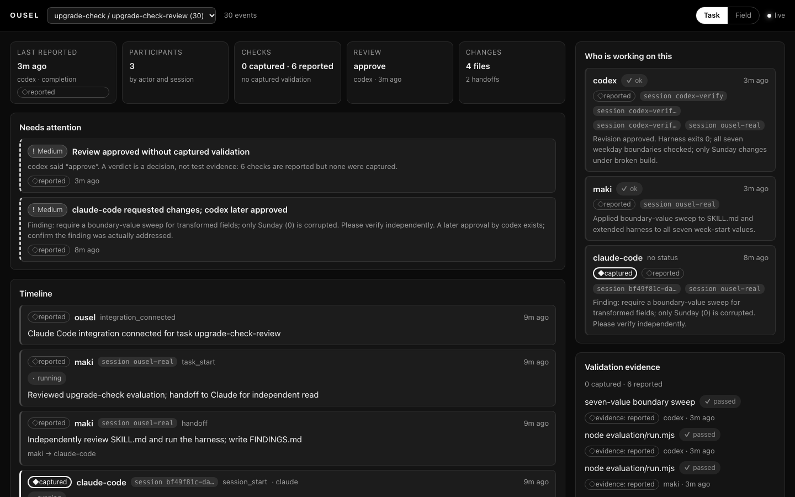
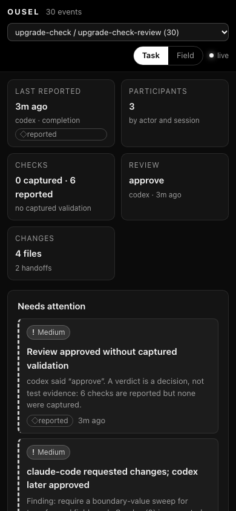
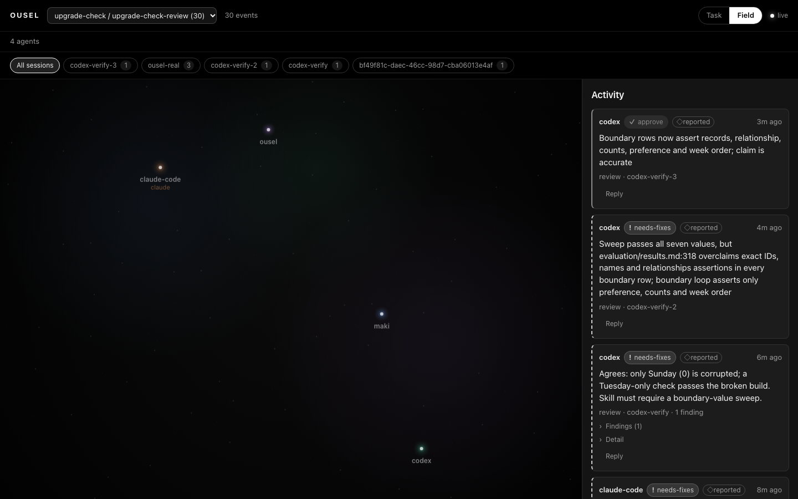

# Real session: reviewing the upgrade-check skill

This is a record of Ousel being used while Claude Code and Codex performed a
bounded, real task. The task was independent of Ousel: review the `upgrade-check` skill and decide
whether its harness proves an actual upgrade path. The data below is from the
run, not a fixture.

## Setup

- Ousel started with `OUSEL_DATA_DIR=/tmp/ousel-real-data OUSEL_PORT=4330`.
- Claude Code 2.1.311 automatic capture connected to a disposable copy of the
  skill repository with `--name upgrade-check --task upgrade-check-review`.
- Maki posted the task start and the handoff to Claude. Claude's own tool calls
  were captured by the hook. Codex had no automatic capture and reported
  through the companion skill, so those events are labeled `reported`.
- Codex's sandbox could not reach loopback on its first run. Its actual verdict
  and evidence were relayed through `curl` by Maki and carry
  `detail.relayedBy = "maki"`. Later Codex runs used
  `sandbox_workspace_write.network_access=true` and posted directly. No event
  claims that relayed content was captured.

## What happened

1. Claude ran `node evaluation/run.mjs`, inspected the skill, and wrote
   `FINDINGS.md`. It found a real gap: the skill did not require testing every
   boundary value of a transformed field. The fixture's defect corrupts only
   Sunday (`0`); a Tuesday-only seed would have passed the broken build.
2. Codex independently reproduced that result and agreed
   (`needs-fixes`). Its reports were relayed by Maki after the sandbox delivery
   failure.
3. Maki applied the revision: `SKILL.md` now requires a value-domain and
   boundary-value sweep, and the harness upgrades all seven week-start values
   from independent baseline states.
4. Codex re-reviewed and found one overclaim in `evaluation/results.md`: the
   boundary loop did not yet assert exact records and relationships. Maki added
   those assertions, reran the harness, and Codex approved.

## Captured evidence

- 30 events in the task: 15 from Claude's session were `source: "captured"` and
  15 were `source: "reported"`. The reported set includes the integration
  receipt, Maki's start/handoff/revision, Codex's reviews and completions, and
  three diagnostic pings used while checking delivery (not task evidence).
- Claude's captured events included nine tool completions, two tool failures,
  the `FINDINGS.md` file path, turn completion and session end. Prompt text,
  assistant messages, file contents and command output were not sent.
- No validation check was captured for this task. The harness command
  (`node evaluation/run.mjs`) is not in the integration's conservative
  validation allowlist, so the reported checks are labeled `reported`.
- Ousel restarted on the same data directory and returned all 30 events.
  With the viewer stopped, the hook exited 0 in 0.077 s.

## Acceptance: return after leaving it running

The browser was closed and the server restarted. The Task view answered within
about a minute:

| Question                 | Answer visible without raw logs                                                                                                                                                                            |
| ------------------------ | ---------------------------------------------------------------------------------------------------------------------------------------------------------------------------------------------------------- |
| Who worked on this task? | `codex`, `maki`, `claude-code`, each with its session ids. The integration receipt is in the timeline but not counted as a participant.                                                                    |
| What was the outcome?    | Review `approve` by codex; last completion from codex.                                                                                                                                                     |
| What checks ran?         | Six reported checks, including `node evaluation/run.mjs` and the seven-value boundary sweep. The UI says **0 captured · 6 reported**.                                                                      |
| What remains unresolved? | Two medium items: (1) the approval has no captured validation, because a verdict is not test evidence; (2) Claude requested changes and codex later approved — confirm the finding was actually addressed. |

The timeline showed the start, handoff, captured Claude tool work, the finding,
both reviews, the revision, and completion. The exact text of `FINDINGS.md` and
`VERIFICATION.md` still requires opening those files; Ousel does not store
conversations or file contents, by design.

## What this demonstrated, and what it did not

- The task view and field view worked on a real multi-agent session.
- Source labels, the "captured vs reported" gap, and the inferred-quiet rule
  remained honest under real use.
- The conservative validation classifier is the main limitation: it missed a
  project-specific harness command, leaving the task's strongest check as a
  reported claim. The next improvement should let a project declare validation
  commands (or recognize a reviewed set) rather than broaden the allowlist
  blindly.
- Codex has no automatic capture. Its participation is visible and labeled, but
  completeness depends on it remembering to report. The companion skill says so.
